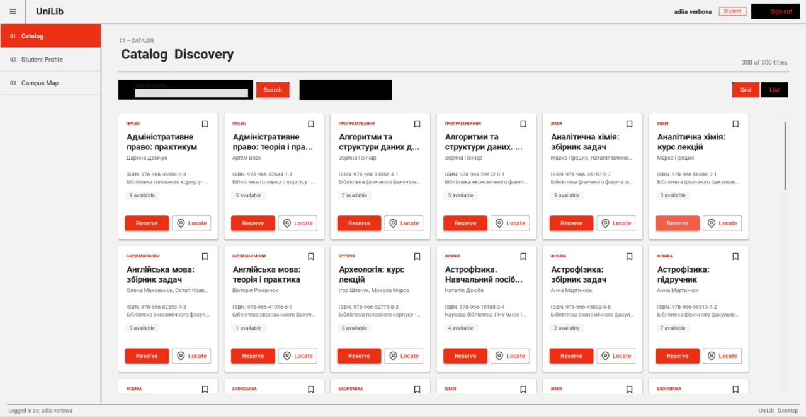
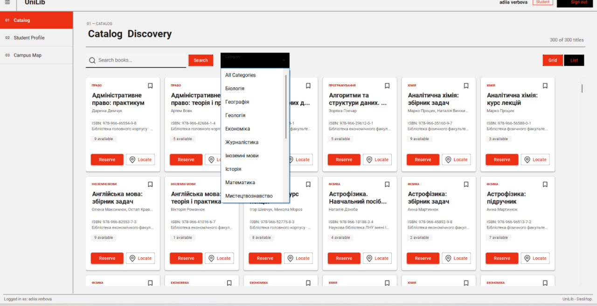
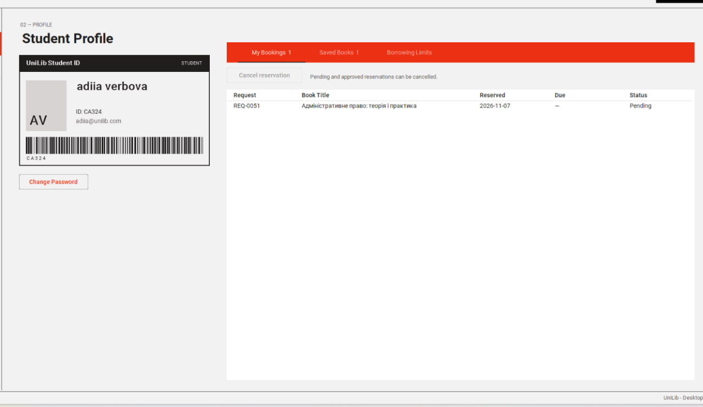
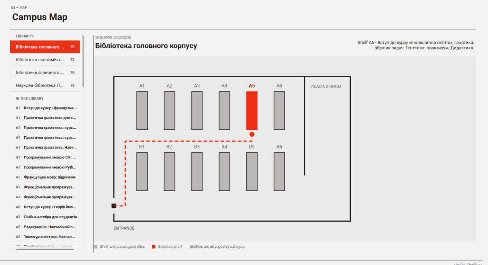

# Львівський національний університет імені Івана Франка

**Факультет прикладної математики та інформатики**  
Кафедра програмування

## Звіт
### етапу виконання проєкту №6

**«Ітеративна реалізація функціональності»**

**Виконали:** студенти групи ПМІ-33

- Вербова Надія Андріївна
- Махновець Богдан Олександрович
- Митюк Маркіян Андрійович
- Нагірняк Вікторія Іванівна

**Перевірив:** ас. Галамага Любомир Борисович

---

## 1. Мета етапу

Поетапна реалізація запланованої функціональності бібліотечної системи **UniLib**: робота в окремих гілках, перегляд коду через запити на включення змін (pull requests), тестування кожної ітерації та регулярна демонстрація проміжного результату. Головний результат етапу — **оновлений дизайн** усіх екранів застосунку та робоча проміжна версія продукту.

---

## 2. Організація роботи в репозиторії

### 2.1. Гілки

Кожне завдання виконувалося в окремій гілці. Зміни потрапляли в `main` тільки через pull request після перегляду коду.

| Гілка | Призначення |
|---|---|
| `feature/test-ui` | Перші форми інтерфейсу та перехід на MaterialSkin |
| `feature/seed-data` | Скрипт і SQL для наповнення бази тестовими даними |
| `unilib-ui` / `unilib-UpdatedUi` | Новий дизайн усіх екранів |
| `library-coordinates` | Координати бібліотек (широта/довгота) і перевірки в базі |
| `unilib-ui-coordinates` | Об'єднання нового дизайну з координатами, виправлення UI |
| `unilib-tests` | Розширення тестів і правила видачі книг |

### 2.2. Запити на включення змін і перегляд коду

| PR | Гілка | Зміст |
|---|---|---|
| #1 | `feature/test-ui` | Перші екрани на MaterialSkin |
| #3 | `unilib-ui-coordinates` | Новий дизайн + координати бібліотек |
| #4 | `unilib-tests` | Правила видачі, 104+ тести, виправлення за результатами рев'ю |

За результатами перегляду коду в PR #4 окремим комітом виправлено зауваження рецензентів:

- облік міграцій для старої бази, створеної без історії міграцій (`DatabaseSetup`);
- ліміт бронювань тепер враховує й підтверджені запити, а не лише ті, що очікують;
- захист від подвійного натискання в панелі адміністратора;
- зрозуміліше повідомлення при неправильному паролі.

Після злиття гілок конфлікт у `ReservationService.cs` розв'язано вручну, а всі тести прогнано повторно.

---

## 3. Оновлення дизайну

На цьому етапі **ми повністю оновили дизайн застосунку**. Усі екрани перебудовано за єдиним стилем UniLib на компонентах **MaterialSkin.2**:

- червоний акцентний колір на світлому тлі;
- квадратні кути та тонкі (2 px) розділові лінії;
- шапка з іменем і роллю користувача та кнопкою **Sign out**;
- бічне меню з нумерованими розділами (01 Catalog, 02 Student Profile, 03 Campus Map);
- рядок стану внизу вікна («Logged in as: …»).

Вхід і реєстрацію об'єднано в одне вікно з постером UniLib. Старі `RegisterForm` і `PasswordTextBox` видалено, а конфліктний пакет MaterialSkin 0.2.1 прибрано.

### 3.1. Каталог (`Catalog Discovery`)

- Картки книг у сітці або списку (перемикач **Grid / List**).
- На картці: категорія, назва, автори, ISBN, бібліотека, кількість вільних примірників, кнопки **Reserve** і **Locate**, закладка «зберегти».
- Пошук за назвою, автором чи ISBN і фільтр за категорією.
- Лічильник «300 of 300 titles». Сітка показує 48 книг за раз із кнопкою «Show more» і зберігає позицію прокрутки.

### 3.2. Профіль студента (`Student Profile`)

- Цифровий студентський квиток: ім'я, ID, email, штрихкод.
- Кнопка **Change Password**.
- Вкладки **My Bookings** (номер запиту, книга, дата, статус, скасування бронювання), **Saved Books** і **Borrowing Limits**.

### 3.3. Мапа кампусу (`Campus Map`)

- Список бібліотек із кількістю книг і координатами вибраної бібліотеки.
- Список книг бібліотеки з номером полиці.
- План залу зі стелажами A1–B6, підсвіченою вибраною полицею та маршрутом від входу.

### 3.4. Панель адміністратора

- Актуальні показники бібліотеки.
- Черга бронювань з діями «підтвердити / відхилити / скасувати рішення».
- Діалог **Add New Book** для додавання книги з авторами й категорією.

---

## 4. Що виконано

**Каталог і книги**
- Додавання книги, категорії й авторів зберігається за один раз: при помилці в базі нічого не лишається, повторна спроба працює.
- Назви категорій і авторів порівнюються без урахування регістру, зокрема для кирилиці.
- Зрозуміле повідомлення, якщо двоє людей одночасно додають той самий ISBN чи категорію.

**Видача і бронювання**
- Видачу заборонено, якщо немає вільних примірників або в користувача вже 5 книг.
- Дата повернення має бути пізнішою за сьогодні.
- При запуску застосунку прострочені видачі автоматично отримують статус «прострочено».
- Ліміт відкритих бронювань і повний цикл статусів, включно з «Reopen» (скасування рішення бібліотекаря).

**Бібліотеки**
- Координати бібліотек з перевіркою діапазону в сервісі та CHECK-обмеженнями в базі; міграція `LibraryCoordinates`.

**Безпека**
- Акаунт адміністратора створюється лише тоді, коли в базі ще немає адміна. Чужий акаунт `admin@unilib.com` із власним паролем не отримує прав адміна.
- Вхід зі стандартним паролем адміна вимагає його змінити. Демо-логін адміна показується лише в Debug-збірці.

**Дані**
- Скрипт наповнення бази тестовими даними (300 книг, 4 бібліотеки).

---

## 5. Що залишилося

- Зберігати номер полиці в базі. Зараз полиця обчислюється за категорією книги.
- Перенести перевірку «не бронювати ту саму книгу двічі» з екрана каталогу в `ReservationService`.
- Узгодити видачу з бронюваннями: не видавати останній примірник, якщо його підтверджено для іншого студента.
- Перевірити пошук кирилицею на PostgreSQL.
- Дописати тести для сервісів, які ще не покрито (`AuthorService`, `CategoryService`, `FacultyService`, `RoleService`).

---

## 6. Проблеми, що виникли

- **Чорна заливка полів введення у фокусі.** Поле пошуку та список категорій у фокусі ставали чорними, і текст не було видно. Виправлено окремим комітом у гілці `unilib-ui-coordinates`.
- **Конфлікт пакетів MaterialSkin.** Старий пакет 0.2.1 конфліктував із MaterialSkin.2, тому його видалено.
- **Конфлікт під час злиття гілок** у `ReservationService.cs`. Розв'язано вручну, тести прогнано повторно.
- **Різниця між SQLite і PostgreSQL.** Тести працюють на SQLite, а застосунок — на PostgreSQL, тому частину поведінки (наприклад, регістр кирилиці в SQL) тести не бачать.

---

## 7. Висновки

1. Робота велася в окремих гілках, зміни потрапляли в `main` через pull request із переглядом коду, а зауваження рецензентів виправлялися окремими комітами.
2. Повністю оновлено дизайн застосунку: каталог, профіль студента, мапа кампусу, вхід і панель адміністратора виконано в єдиному стилі UniLib.
3. Реалізовано правила видачі й бронювання, координати бібліотек і захист акаунта адміністратора.
4. Отримано робочу проміжну версію продукту. Перелік того, що залишилося, визначено для наступної ітерації.
